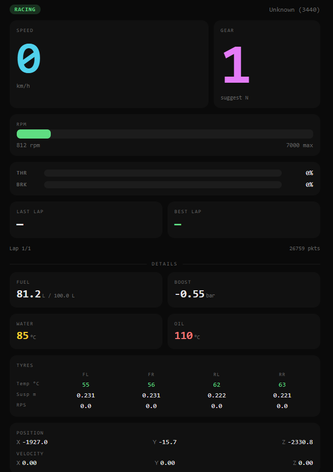

# GT7 Telemetry

Decrypts Gran Turismo 7's Salsa20-encrypted UDP telemetry from a PS5 and shows it live. Two front-ends, same parser:

- **`gt7_web.py`**: phone-friendly browser dashboard with a live track map and a voice coach. Serves on port `7000`.
- **`gt7_telemetry.py`**: ANSI terminal dashboard.

## Requirements

- Python 3.10+
- A PS5 on the same network as this computer, with GT7 running.
- Optional, for the voice coach: an OpenAI-compatible LLM endpoint and an OpenAI-compatible TTS endpoint (e.g. [cleanTTS](https://github.com/stavrostzagadouris/cleanTTS)).

## Setup

```sh
python3 -m venv .venv
.venv/bin/pip install -r requirements.txt
cp .env.example .env
```

Then open `.env` and fill it in:

```ini
GT7_PS5_IP=192.168.1.50                 # required: your PS5's LAN IP
GT7_LLM_URL=http://<llm-host>:1234/v1   # optional: coach phrasing
GT7_LLM_MODEL=                          # optional: blank = first model listed
GT7_TTS_URL=http://<tts-host>:5000/v1   # optional: coach voice
GT7_TTS_VOICE=                          # optional: blank = bm_george
```

`.env` is git-ignored, so your addresses stay out of the repo.

### Finding your PS5's IP

On the PS5: **Settings → Network → Connection Status → View Connection Status**, and use the **IPv4 Address**.

If the address changes from day to day, give the PS5 a DHCP reservation on your router. Or skip editing `.env` and pass the address when you start the dashboard:

```sh
.venv/bin/python gt7_web.py --ps5-ip 192.168.1.50
```

`--ps5-ip` wins over `GT7_PS5_IP` from the environment, which wins over `.env`.

## Run

**Web dashboard (recommended):**

```sh
.venv/bin/python gt7_web.py
```

On your phone, on the same Wi-Fi, open `http://<this-computer's-ip>:7000`. Tap **TAP FOR COACH** once so the phone allows the coach's audio. Tap it again to mute.

**Terminal dashboard:**

```sh
.venv/bin/python gt7_telemetry.py
```

Both bind UDP port `33740`, so run **one at a time**.

### Checklist when it shows NO DATA

1. GT7 is running and you're past the title screen.
2. `GT7_PS5_IP` is right. The startup line shows the IP the heartbeat is going to.
3. This computer and the PS5 are on the same network, and no firewall blocks UDP `33740` inbound.

## Voice coach

`gt7_web.py` runs a race-engineer coach unless you pass `--no-coach`. It never sees the screen; it works from telemetry alone.

1. **Rules spot what happened** (`coach.py`): front lock-ups, wheelspin or TCS on exit, coasting, the rev limiter, brake/throttle overlap, and corners taken slower than your best lap. At the end of each lap there's a debrief covering your time against your best, fuel per lap, and your biggest corner losses.
2. **The LLM decides how to say it.** It gets the facts as JSON, a plain-English description of the event, and its last 8 lines so it doesn't repeat itself. It's told to use only the facts it's given, so it can't invent pit calls or problems. Thinking is turned off (`chat_template_kwargs: {"enable_thinking": false}`), so replies take about 0.2 s.
3. **TTS speaks it.** The mp3 goes to the dashboard over the WebSocket and plays on your phone, with a caption.
4. **It waits for a straight.** It won't talk mid-corner, keeps at least 7 s between lines, and drops a callout if no straight comes within 10 s. Lap debriefs can wait 60 s.

Your personal-best lap for each car and track is saved to `coach_refs.json`. That's what "slower than your best" compares against, so corner comparisons start after you've set a best lap.

If `GT7_LLM_URL` is blank or the LLM is down, the coach speaks fixed fallback lines. If `GT7_TTS_URL` is blank or TTS is down, callouts show as captions only.

## Notes

- **Heartbeat:** `~` is sent to the PS5 on port `33739` every 10 seconds. GT7 stops sending if it doesn't hear one within about 16 seconds. `~` asks for GT7's longest packet format (`0x158` bytes), which adds steering angle, sway/heave/surge, filtered throttle/brake and energy recovery. Change `HEARTBEAT_PACKET` in `gt7_telemetry.py` to `b"A"` if your firmware doesn't respond to it.
- **Wheel slip** is tyre surface speed ÷ car speed: about 1.00 when rolling, above 1 for wheelspin, below 1 for lock-up.
- **Track position:** GT7 doesn't send a track ID, so the car's X/Z is matched against centerlines in `tracks/`. Right now that's only the Nürburgring Nordschleife, from a lap dump in [vthinsel/GT7Tracks](https://github.com/vthinsel/GT7Tracks) (MIT), cleaned and resampled every 5 m. Turns were auto-detected from curvature and only a few are named; rename them in `tracks/nordschleife_turns.csv`.
- **Car names** are fetched once at startup from [ddm999/gt7info](https://github.com/ddm999/gt7info). If the fetch fails you'll see numeric car codes.
